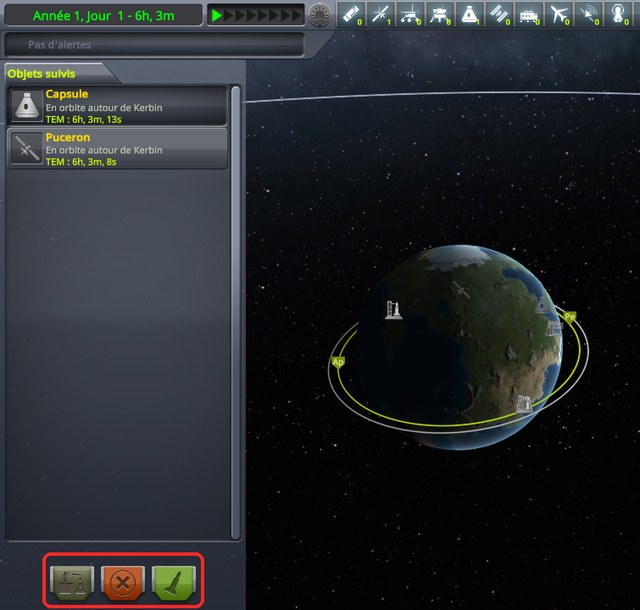
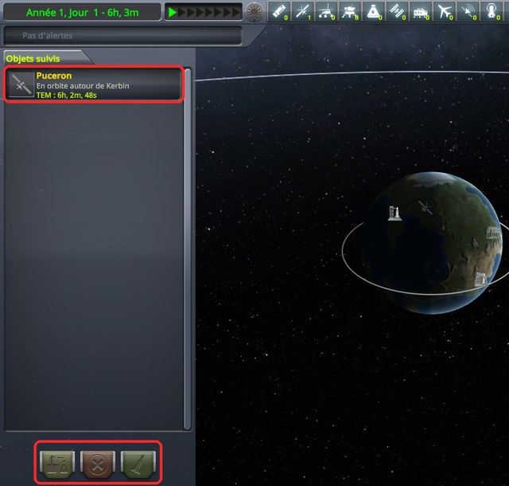
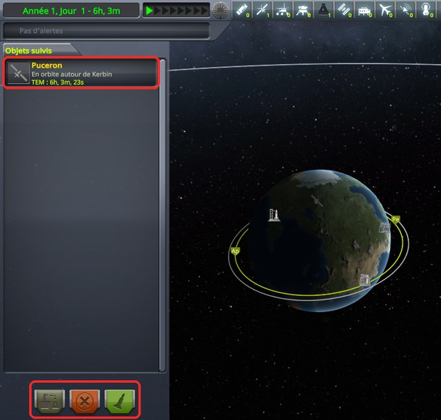

# Tracking Selection Fix

**⚠️ Not finished yet.** This is a new fix, not a finished mod. The code and the conclusions on this page can still change.

A fix for stock KSP 1.12, kept as small as possible: two Harmony patches, in two short source files. It is a
mod of its own, built on top of
[KSP Community Fixes](https://github.com/KSPModdingLibs/KSPCommunityFixes), the base most players run.
Here is what it fixes:

> **In the tracking station, after a vessel is terminated or recovered, or a filter changes the list, the top
> row of the list looks selected while nothing is, and a click on it does nothing.** And when a filter hides
> the selected vessel, that vessel stays selected: *Fly* and *Terminate* act on a vessel the list no longer
> shows, while another row looks selected.

**How this was made.** The investigation and the code were written with Claude, Anthropic's AI
assistant. Everything here was reviewed and validated by a human — me. I am saying so up front, because
contributions made with an AI deserve a closer look than others, and because some people would rather
stop reading here. That look should be quick: the stock code involved is named on this page, every check
below is read on screenshots of the game, taken by a public script that plays its protocol, and the fix is
two short files you can read in a few minutes.

## Why it matters

The list of the tracking station is how a player picks a vessel to fly, recover or terminate. After a vessel
is terminated, the list is rebuilt, and its top row comes back dark, as a selected row does. The *Fly*,
*Recover* and *Terminate* buttons stay grey: nothing is selected. A click on that row changes nothing, however
many times it is clicked. Below, two vessels, Capsule selected, then terminated:

 

*KSP 1.12.5 without this mod, with [KSP Community Fixes](https://github.com/KSPModdingLibs/KSPCommunityFixes),
in French, in a 1280 × 720 window, in the tracking station of
[tracking-selection-two.sfs](diag/tracking-selection-two.sfs), a sandbox game with two vessels around Kerbin:
Capsule, a ship, and Puceron, a probe. Capsule clicked, then terminated. Rings drawn on the screenshots.*

The player who does not know why thinks the vessel cannot be selected. It happens after *Recover* and
*End Track* too, and when the game loses an untracked asteroid while the tracking station is open.

A filter that hides the selected vessel is worse: the vessel stays selected, with no row, and the buttons act
on it, while the row left on top looks selected. Below, Capsule selected, then ships hidden by their filter:

 

*The same game and save. Capsule clicked, then the filter of ships clicked, in the top bar.*

Here, *Fly* and *Terminate* act on Capsule, which the list no longer shows, not on Puceron. The protocol of
[Checking a filter](docs/checking-filter.md) plays such a case through to *Fly*: the flight opens on the hidden
vessel.

## The culprit: the list's toggle group lights its first row by itself

Each row of the list is a `Toggle` (`TrackingStationWidget.toggle`), and the rows share one `ToggleGroup`
(`SpaceTracking.listToggleGroup`) that does not allow all its toggles to be off (`allowSwitchOff` is false).

- **The rebuild.** `SpaceTracking.ConstructUIList` removes the old rows (`TrackingStationWidget.Terminate`:
  `UnregisterToggle`, then `Object.Destroy`), creates the new ones in the group, then selects
  `SpaceTracking.SelectedVessel` again if there is one (`SetVessel`). After *Terminate*, *Recover* or *End
  Track*, there is none: those buttons deselect the vessel first.
- **The end of the frame.** Unity destroys the old rows then. `Toggle.OnDestroy` asks the toggle's group
  to check its state, and the removed row still names the group: `UnregisterToggle` took it out of the
  group's list, not the group out of the toggle. `ToggleGroup.EnsureValidState` finds no toggle on and switches
  the first one on:

  ```csharp
  // UnityEngine.UI.ToggleGroup.EnsureValidState, Unity 2019.4
  if (!allowSwitchOff && !AnyTogglesOn() && m_Toggles.Count != 0)
  {
      m_Toggles[0].isOn = true;
      NotifyToggleOn(m_Toggles[0]);
  }
  ```

- **The dead click.** That row is now on, and `TrackingStationWidget.onToggle` has marked it selected, without
  telling the station: the pointer was not over it. A click on a toggle that is on turns it off, the group
  turns it straight back on, and `onToggle(true)` sees a row already selected, which only acts on a double
  click. So a single click does nothing.
- **The hidden vessel.** A filter rebuilds the list through the same `ConstructUIList`. When the filter hides
  the selected vessel, `SetVessel(SelectedVessel)` finds no row for it, lights none, and leaves it selected,
  its buttons on.

## The fix

Two patches, each with its own switch in [Settings](#settings), on by default. Nothing is saved; removing the
mod gives the stock behaviour back at once.

- **`releaseRemovedRows`.** After `TrackingStationWidget.Terminate`, the mod sets the removed row's
  `toggle.group` to null. When Unity destroys the row, `Toggle.OnDestroy` has no group to check, and the new
  list keeps no row on when no vessel is selected, as it does when the tracking station opens. A click on any
  row then selects its vessel. The group still never lets its lit row go off: a click on the selected row
  leaves it selected, as on stock.

  **Why not let the group switch all its rows off.** `allowSwitchOff = true` on `listToggleGroup` also stops
  the top row from lighting by itself, but then a click on the selected row turns it off (`Toggle.Set` no
  longer turns it back on) while its vessel stays selected.

  **Why not answer the click on the lit row.** A patch of `TrackingStationWidget.onToggle` could select the
  vessel of a row that is on but not selected; the top row would still look selected while nothing is.

- **`deselectHiddenVessel`.** Before `SpaceTracking.ConstructUIList`, when `MapViewFiltering.CheckAgainstFilter`
  says the filters hide the selected vessel, the mod calls `SpaceTracking.SetVessel(null, true)`, as *End
  Track* does for a vessel that leaves the list but stays in the game. *Fly*, *Recover* and *Terminate* go
  grey until a vessel of the list is clicked. A vessel selected by its icon while the list does not show it
  (an untracked object) is left alone, as long as the filters do not hide it.

## Checked: Terminate

The list shows Capsule on top, then Puceron and three other vessels, none selected. Puceron is clicked,
terminated, then the top row is clicked. On stock, the top row, Capsule, comes back dark with nothing selected,
and the click changes nothing; with this mod, no row is dark, and the click selects Capsule.

**→ Full chapter: [Checking Terminate](docs/checking-terminate.md)**

## Checked: Recover

The list shows Capsule on top and, among the vessels below, a rover on the runway, none selected. The rover is
clicked, recovered, then the top row is clicked. On stock, the top row comes back dark with nothing selected, and
the click changes nothing; with this mod, the click selects Capsule.

**→ Full chapter: [Checking Recover](docs/checking-recover.md)**

## Checked: End Track

The list shows Capsule on top and a tracked asteroid at the bottom, none selected. The asteroid is clicked, its
tracking ended, then the top row is clicked. On stock, the top row comes back dark with nothing selected, and the
click changes nothing; with this mod, the click selects Capsule.

**→ Full chapter: [Checking End Track](docs/checking-end-track.md)**

## Checked: an object lost

The list shows Capsule on top, none selected. An untracked asteroid, which has no row, is lost while the tracking
station is open; then the top row is clicked. On stock, the top row turns dark by itself, and the click changes
nothing; with this mod, it stays light, and the click selects Capsule.

**→ Full chapter: [Checking an object lost](docs/checking-lost-object.md)**

## Checked: a filter

The list shows Capsule, the only ship, on top, and below it Quad-Rocket, a station, none selected. Quad-Rocket is
clicked, ships alone are shown, the top row is clicked, then *Fly*. On stock, Quad-Rocket stays selected and the
flight opens on it; with this mod, it is deselected, the click selects Capsule, and the flight opens on Capsule.

**→ Full chapter: [Checking a filter](docs/checking-filter.md)**

## Checked: the clicks that already worked

A row is clicked, clicked again, and another one double-clicked. On stock as with this mod, the click selects
the vessel, the second click leaves it selected, and the double click flies the other vessel.

**→ Full chapter: [Checking the clicks that already worked](docs/checking-clicks.md)**

## Checked: Tracking Station Evolved

Tracking Station Evolved hides the station's list and shows its own rows, which pass clicks on to the hidden ones.
Without this mod, the defect shows there too, on Capsule's row, after each trigger above; with it, every protocol
passes.

**→ Full chapter: [Checking Tracking Station Evolved](docs/checking-tracking-station-evolved.md)**

## Work in progress

What a player would see if this mod broke something, and how to try it by hand, with the mod and without:

- **A list longer than the screen.** The rows of a long list scroll. If the mod broke them, a row scrolled
  into view would not respond to a click, or two rows would look selected. With some fifteen tracked vessels,
  terminate one, scroll down, click a row near the bottom, then one near the top.
- **Missions of Making History.** The tracking station of a mission switches between its tracked objects and
  its mission objectives, and rebuilds the list on its own. If the mod broke them, a row would not respond
  after switching tabs. Play a mission with several vessels, open the tracking station, switch to the
  objectives and back, terminate a vessel, then click the top row.
- **An asteroid found while the tracking station is open.** Finding one rebuilds the list as losing one does.
  If the mod broke it, the new asteroid's row or the top row would not respond. In a new sandbox game, open the
  tracking station at once and wait, nothing selected, until the game logs `[AsteroidSpawner]: New object found`,
  then click the top row.
- **Other mods that add to the tracking station.** Besides
  [Tracking Station Evolved](docs/checking-tracking-station-evolved.md), checked, a mod that adds rows or buttons
  there, or rebuilds the list itself, could rely on the top row lighting by itself. With such a mod installed, terminate a vessel, then
  click the top row and that mod's own controls.

## Install

Copy the `GameData\KSPFixTrackingSelection` folder into the `GameData` folder of KSP. It needs
[Harmony](https://github.com/KSPModdingLibs/HarmonyKSP), as KSP Community Fixes does.

## Settings

`GameData\KSPFixTrackingSelection\PluginData\settings.cfg` is read once, when KSP starts:

```
// Takes each row the tracking station removes from its list out of the list's toggle group at once.
releaseRemovedRows = True

// Deselects the tracking station's selected vessel when the vessel type filters hide it.
deselectHiddenVessel = True

// How much the mod writes to KSP.log: Error, Warning, Info or Debug.
logLevel = Info
```

- With `releaseRemovedRows = False`, the top row lights by itself after a rebuild, as on stock.
- With `deselectHiddenVessel = False`, a vessel the filters hide stays selected, as on stock.
- At `Debug`, the mod writes one line to `KSP.log` for each row a rebuild of the list removes, and one for each
  vessel it deselects because the filters hide it.

## Build

Set `KSPDIR` to the folder of a KSP install with Harmony in its `GameData`, then run `build.bat`: it
compiles `GameData\KSPFixTrackingSelection\KSPFixTrackingSelection.dll`. Installing is up to you.

## License

[MIT](LICENSE).
