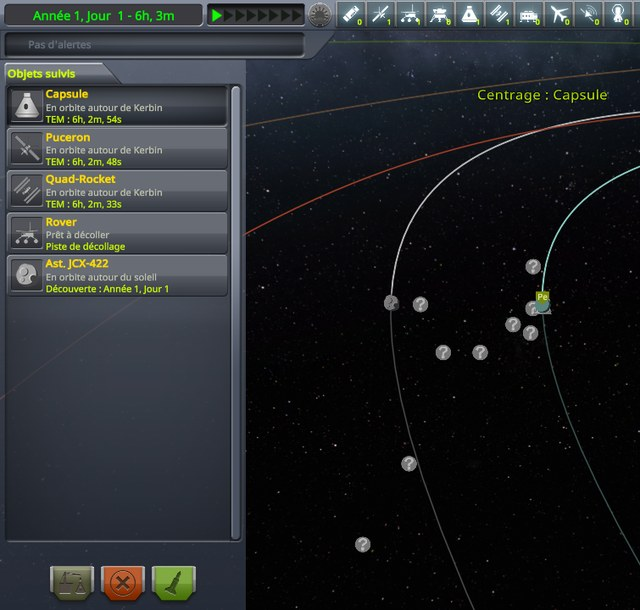
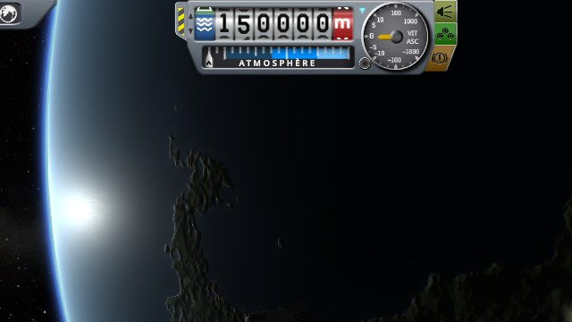
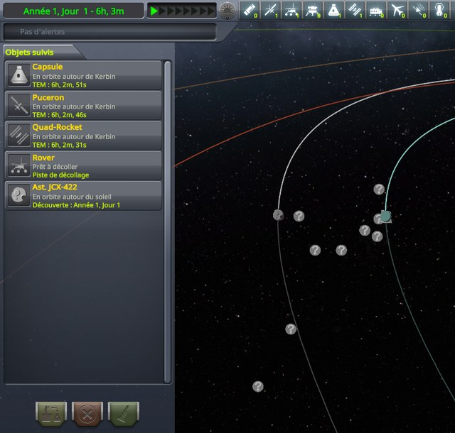
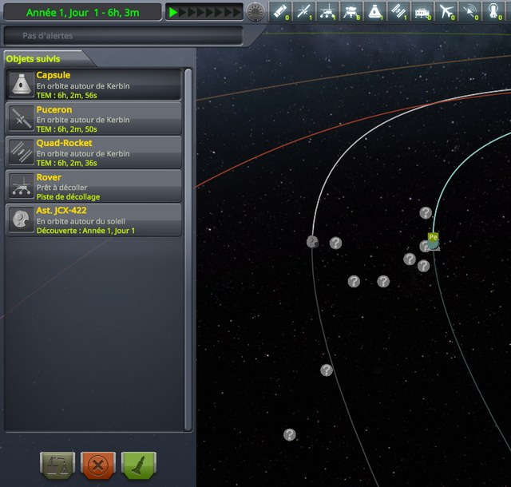
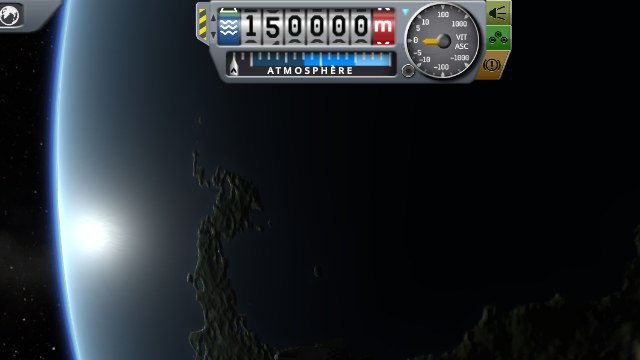

# Checking the clicks that already worked

Part of [Tracking Selection Fix](../README.md). A row is clicked, clicked again, and another one double-clicked. Do they still do what they do on stock: select, leave selected, fly? Played without this mod, then with it.

## The install

The same as for [Terminate](checking-terminate.md#the-install).

## The protocol

The save, [tracking-selection.sfs](../diag/tracking-selection.sfs): a sandbox game with, around Kerbin, a
capsule in orbit at 100 km (Capsule, a ship), a probe at 150 km (Puceron), a station at 200 km (Quad-Rocket), a
rover on the runway (Rover, the vessel it opens on), and a tracked asteroid (Ast. JCX-422), plus nine untracked
asteroids, which keep the game from finding new ones while the protocol runs. Every vessel filter is on. Copy it
into the folder of a sandbox game, and load it. Then leave the flight for the space centre, and open the tracking
station. On a first visit, it shows a welcome message: close it.

1. Click Capsule.
2. Click Capsule again.
3. Double-click Puceron.

**Played by a script.** [run-selection.py](../diag/automation/run-selection.py), with `--protocol clicks`. It loads the save, goes to the space centre and to the tracking station as the game's buttons do, and closes a welcome message by its button if one shows. It clicks with the mouse tools of KSP-Util-MCPServer, in the middle of each row and button, which it finds with the server's `read_tracking_station`; and the first button of a confirmation dialog, found with `read_dialogs`. Its double click is two clicks in a row, as a player's.

A screenshot follows each step, the mouse resting right of the list. The images below are the left
part of the screen, 755 by 720 pixels, at 640 pixels wide: the list of tracked objects, its buttons at the
bottom (*Recover*, *Terminate* or *End Track*, *Fly*, from left to right; grey when they do not respond), and the
name of the object the view turns to, which shows for a few seconds at the top of the view (*Centrage : …*). A
selected row is darker than the others. In flight, the image is the top middle of the screen, 640 by 360 pixels: the altimeter
tells which vessel flies (Capsule at 100 km, Puceron at 150 km, Quad-Rocket at 200 km).

## On stock

Read off the screenshots below:

| Step | Row that looks selected | Message at the top of the view | Buttons that respond |
|---|---|---|---|
| 1. The tracking station | none | none | none |
| 2. Click on Capsule | Capsule | Centrage : Capsule | Terminate, Fly |
| 3. Click on Capsule again | Capsule | none | Terminate, Fly |
| 4. Double click on Puceron | — | — | the altimeter reads 150 000 m: Puceron |

   

The 4 screenshots, on stock

The tracking station:

After the click on Capsule:

After the second click on Capsule:

After the double click on Puceron:

## With this mod

Read off the screenshots below:

| Step | Row that looks selected | Message at the top of the view | Buttons that respond |
|---|---|---|---|
| 1. The tracking station | none | none | none |
| 2. Click on Capsule | Capsule | Centrage : Capsule | Terminate, Fly |
| 3. Click on Capsule again | Capsule | none | Terminate, Fly |
| 4. Double click on Puceron | — | — | the altimeter reads 150 000 m: Puceron |

The same as on stock: the second click leaves Capsule selected, and the double click flies Puceron.

   

The 4 screenshots, with this mod

The tracking station:

After the click on Capsule:

After the second click on Capsule:

After the double click on Puceron:

