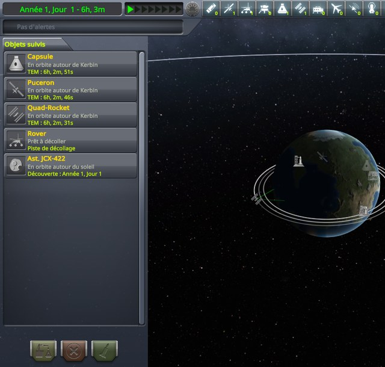
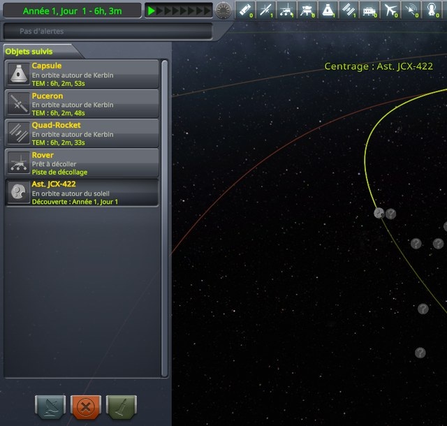
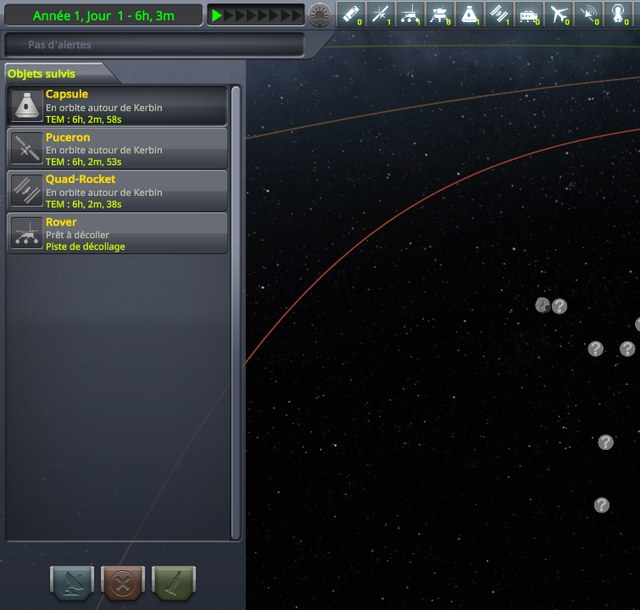
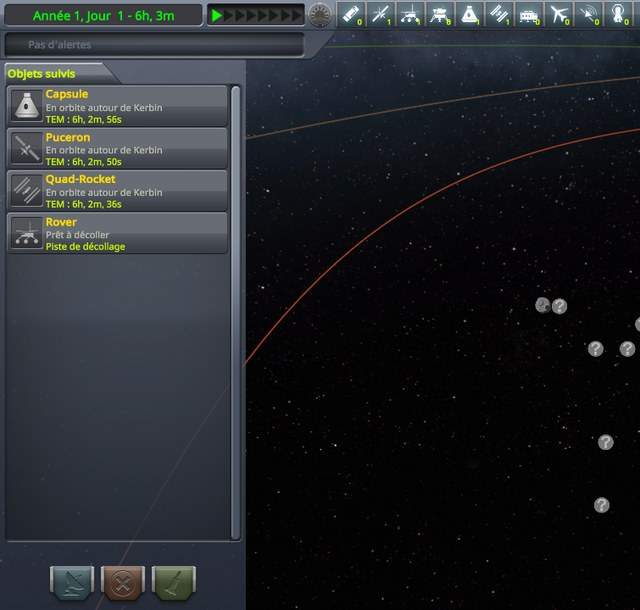
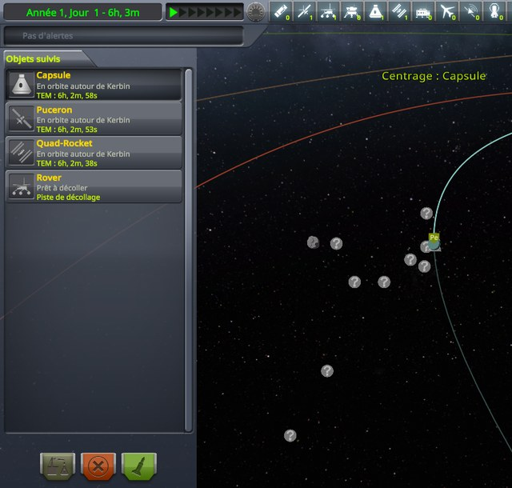

# Checking End Track

Part of [Tracking Selection Fix](../README.md). The tracking of an asteroid is ended from the tracking station, then the top row of the list is clicked. Does a single click on it select its vessel? Played without this mod, then with it.

## The install

The same as for [Terminate](checking-terminate.md#the-install).

## The protocol

The save, [tracking-selection.sfs](../diag/tracking-selection.sfs): a sandbox game with, around Kerbin, a
capsule in orbit at 100 km (Capsule, a ship), a probe at 150 km (Puceron), a station at 200 km (Quad-Rocket), a
rover on the runway (Rover, the vessel it opens on), and a tracked asteroid (Ast. JCX-422), plus nine untracked
asteroids, which keep the game from finding new ones while the protocol runs. Every vessel filter is on. Copy it
into the folder of a sandbox game, and load it. Then leave the flight for the space centre, and open the tracking
station. On a first visit, it shows a welcome message: close it.

1. Click Ast. JCX-422.
2. Click *End Track*, the button *Terminate* becomes for an object the player does not own, and confirm.
3. Click the top row, Capsule, once.

**Played by a script.** [run-selection.py](../diag/automation/run-selection.py), with `--protocol end-track`. It loads the save, goes to the space centre and to the tracking station as the game's buttons do, and closes a welcome message by its button if one shows. It clicks with the mouse tools of KSP-Util-MCPServer, in the middle of each row and button, which it finds with the server's `read_tracking_station`; and the first button of a confirmation dialog, found with `read_dialogs`.

A screenshot follows each step, the mouse resting right of the list. The images below are the left
part of the screen, 755 by 720 pixels, at 640 pixels wide: the list of tracked objects, its buttons at the
bottom (*Recover*, *Terminate* or *End Track*, *Fly*, from left to right; grey when they do not respond), and the
name of the object the view turns to, which shows for a few seconds at the top of the view (*Centrage : …*). A
selected row is darker than the others.

## On stock

Read off the screenshots below:

| Step | Row that looks selected | Message at the top of the view | Buttons that respond |
|---|---|---|---|
| 1. The tracking station | none | none | none |
| 2. Click on Ast. JCX-422 | Ast. JCX-422 | Centrage : Ast. JCX-422 | End Track |
| 3. End Track | Capsule | none | none |
| 4. Click on the top row | Capsule | none | none |

The asteroid leaves the list. The top row comes back dark, with nothing selected, and the click on it changes nothing.

   

The 4 screenshots, on stock

The tracking station:

After the click on Ast. JCX-422:

After End Track:

After the click on the top row:

## With this mod

Read off the screenshots below:

| Step | Row that looks selected | Message at the top of the view | Buttons that respond |
|---|---|---|---|
| 1. The tracking station | none | none | none |
| 2. Click on Ast. JCX-422 | Ast. JCX-422 | Centrage : Ast. JCX-422 | End Track |
| 3. End Track | none | none | none |
| 4. Click on the top row | Capsule | Centrage : Capsule | Terminate, Fly |

The asteroid leaves the list. No row comes back dark, and the click on the top row selects Capsule.

   

The 4 screenshots, with this mod

The tracking station:

After the click on Ast. JCX-422:

After End Track:

After the click on the top row:

