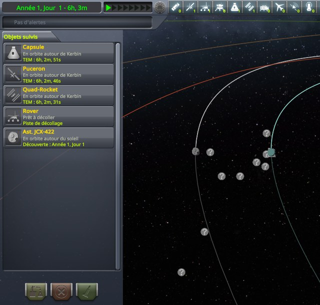
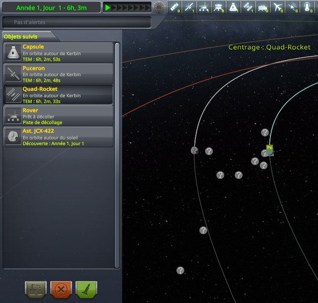
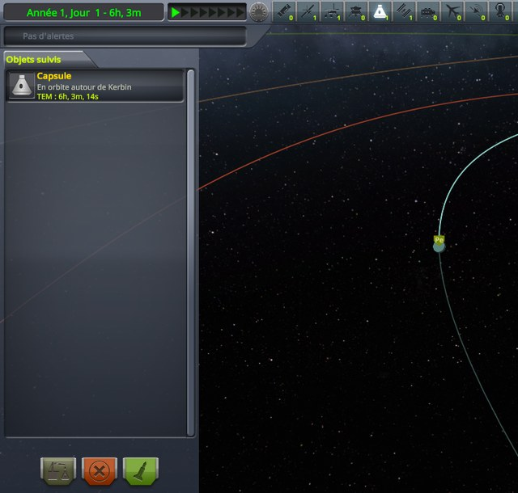
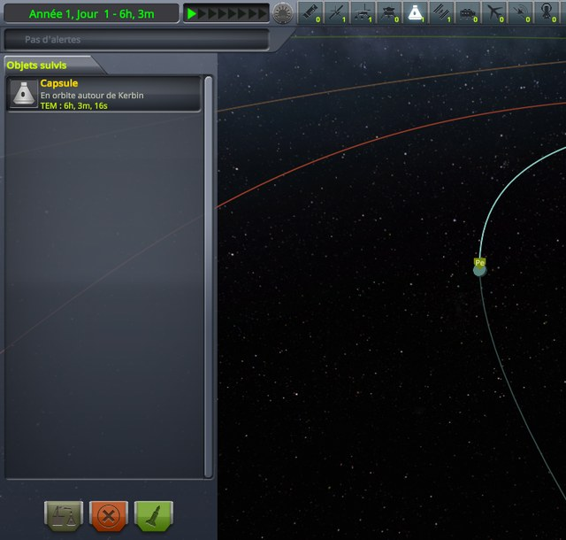
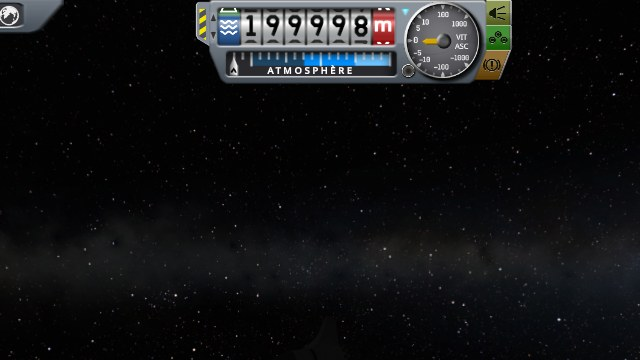
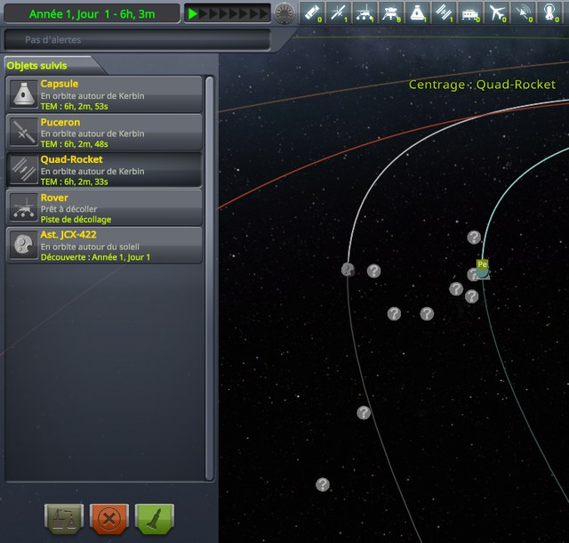
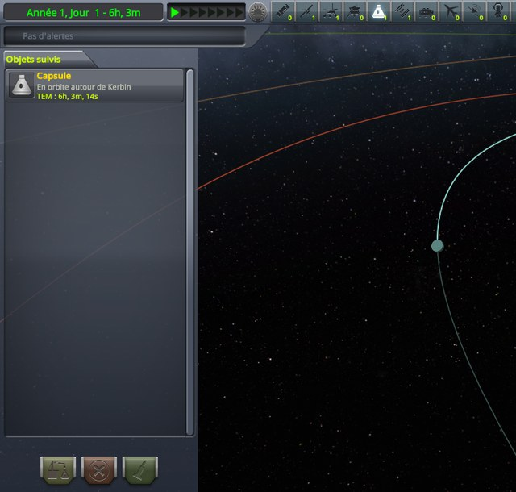
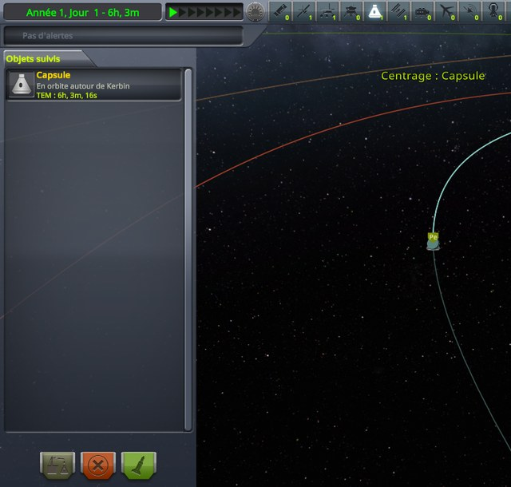
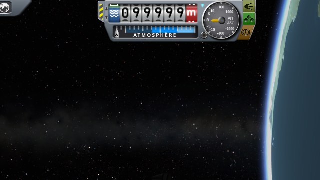

# Checking a filter

Part of [Tracking Selection Fix](../README.md). A filter of the tracking station hides the selected vessel; then the top row is clicked, and *Fly*. Which vessel flies? Played without this mod, then with it.

## The install

The same as for [Terminate](checking-terminate.md#the-install).

## The protocol

The save, [tracking-selection.sfs](../diag/tracking-selection.sfs): a sandbox game with, around Kerbin, a
capsule in orbit at 100 km (Capsule, a ship), a probe at 150 km (Puceron), a station at 200 km (Quad-Rocket), a
rover on the runway (Rover, the vessel it opens on), and a tracked asteroid (Ast. JCX-422), plus nine untracked
asteroids, which keep the game from finding new ones while the protocol runs. Every vessel filter is on. Copy it
into the folder of a sandbox game, and load it. Then leave the flight for the space centre, and open the tracking
station. On a first visit, it shows a welcome message: close it.

1. Click Quad-Rocket.
2. Right-click the *Ships* filter of the top bar: that shows ships alone, Capsule.
3. Click the top row, Capsule, once.
4. Click *Fly*.

**Played by a script.** [run-selection.py](../diag/automation/run-selection.py), with `--protocol filter`. It loads the save, goes to the space centre and to the tracking station as the game's buttons do, and closes a welcome message by its button if one shows. It clicks with the mouse tools of KSP-Util-MCPServer, in the middle of each row and button, which it finds with the server's `read_tracking_station`; and the first button of a confirmation dialog, found with `read_dialogs`. It finds the *Ships* filter by moving the pointer along the top bar first and reading what lies under it.

A screenshot follows each step, the mouse resting right of the list. The images below are the left
part of the screen, 755 by 720 pixels, at 640 pixels wide: the list of tracked objects, its buttons at the
bottom (*Recover*, *Terminate* or *End Track*, *Fly*, from left to right; grey when they do not respond), and the
name of the object the view turns to, which shows for a few seconds at the top of the view (*Centrage : …*). A
selected row is darker than the others. In flight, the image is the top middle of the screen, 640 by 360 pixels: the altimeter
tells which vessel flies (Capsule at 100 km, Puceron at 150 km, Quad-Rocket at 200 km).

## On stock

Read off the screenshots below:

| Step | Row that looks selected | Message at the top of the view | Buttons that respond |
|---|---|---|---|
| 1. The tracking station | none | none | none |
| 2. Click on Quad-Rocket | Quad-Rocket | Centrage : Quad-Rocket | Terminate, Fly |
| 3. Right-click on *Ships* | Capsule | none | Terminate, Fly |
| 4. Click on the top row | Capsule | none | Terminate, Fly |
| 5. *Fly* | — | — | the altimeter reads 199 998 m: Quad-Rocket |

Capsule looks selected once ships alone show, yet the buttons respond for Quad-Rocket, which has no row: *Fly* flies it.

<p class="thumbs"><a href="../imgs/checking-filter/stock/1-tracking-station.jpg"></a> <a href="../imgs/checking-filter/stock/2-quad-rocket-clicked.jpg"></a> <a href="../imgs/checking-filter/stock/3-ships-right-clicked.jpg"></a> <a href="../imgs/checking-filter/stock/4-top-row-clicked.jpg"></a> <a href="../imgs/checking-filter/stock/5-fly-clicked.jpg"></a></p>

<details>
<summary>The 5 screenshots, on stock</summary>

The tracking station:


After the click on Quad-Rocket:


After the right-click on Ships:


After the click on the top row:


After Fly:


</details>

## With this mod

Read off the screenshots below:

| Step | Row that looks selected | Message at the top of the view | Buttons that respond |
|---|---|---|---|
| 1. The tracking station | none | none | none |
| 2. Click on Quad-Rocket | Quad-Rocket | Centrage : Quad-Rocket | Terminate, Fly |
| 3. Right-click on *Ships* | none | none | none |
| 4. Click on the top row | Capsule | Centrage : Capsule | Terminate, Fly |
| 5. *Fly* | — | — | the altimeter reads 99 999 m: Capsule |

Quad-Rocket is deselected when the filter hides it, and the click on the top row selects Capsule, which *Fly* flies. The log of the mod says so:

```
[KSPFixTrackingSelection] [DEBUG] Quad-Rocket is selected but the filters hide it: deselected
```

<p class="thumbs"><a href="../imgs/checking-filter/fix/1-tracking-station.jpg"></a> <a href="../imgs/checking-filter/fix/2-quad-rocket-clicked.jpg"></a> <a href="../imgs/checking-filter/fix/3-ships-right-clicked.jpg"></a> <a href="../imgs/checking-filter/fix/4-top-row-clicked.jpg"></a> <a href="../imgs/checking-filter/fix/5-fly-clicked.jpg"></a></p>

<details>
<summary>The 5 screenshots, with this mod</summary>

The tracking station:


After the click on Quad-Rocket:


After the right-click on Ships:


After the click on the top row:


After Fly:


</details>
