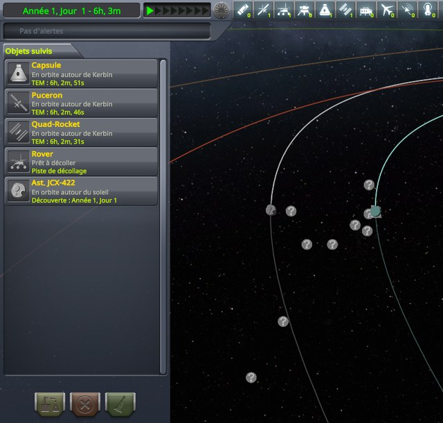
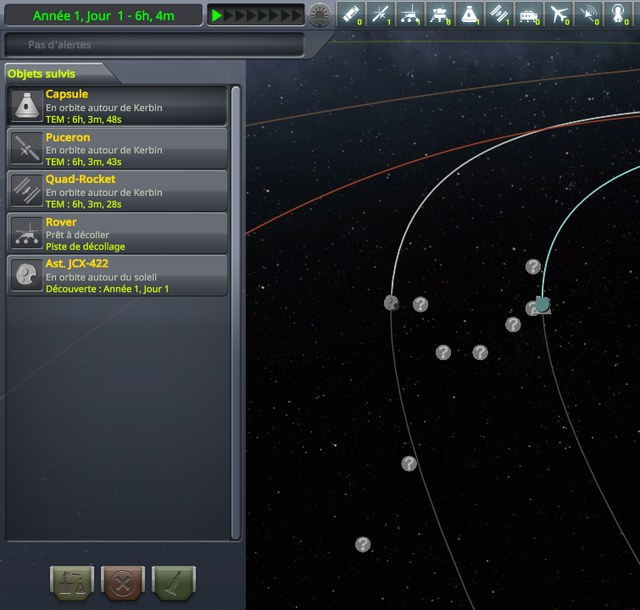
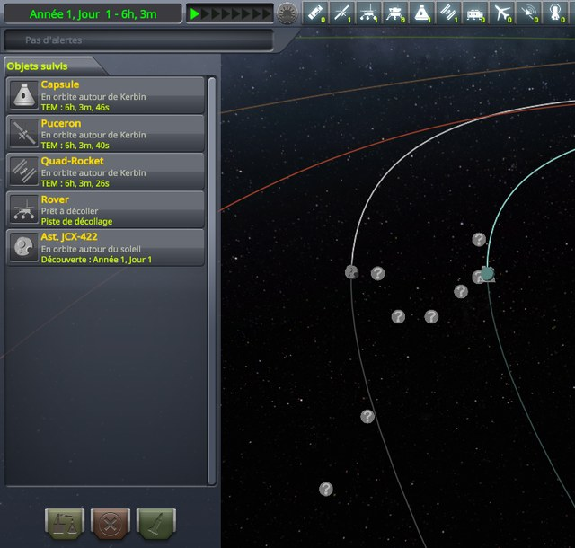
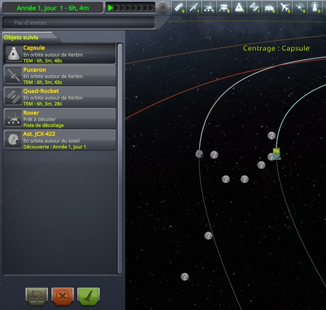

# Checking an object lost

Part of [Tracking Selection Fix](../README.md). The game loses an untracked asteroid while the tracking station is open, nothing selected: an object destroyed, which rebuilds the list. Then the top row is clicked. Does a single click on it select its vessel? Played without this mod, then with it.

## The install

The same as for [Terminate](checking-terminate.md#the-install).

## The protocol

The save, [tracking-selection-lost.sfs](../diag/tracking-selection-lost.sfs): a sandbox game with, around Kerbin, a
capsule in orbit at 100 km (Capsule, a ship), a probe at 150 km (Puceron), a station at 200 km (Quad-Rocket), a
rover on the runway (Rover, the vessel it opens on), and a tracked asteroid (Ast. JCX-422), plus nine untracked
asteroids, which keep the game from finding new ones while the protocol runs; one of them, Ast. XCX-633,
is lost a minute after the save's time. Every vessel filter is on. Copy it
into the folder of a sandbox game, and load it. Then leave the flight for the space centre, and open the tracking
station, at once. On a first visit, it shows a welcome message: close it.

1. Click nothing, and wait until `KSP.log` says that an object is lost, about a minute after the save was loaded:

   ```
   [AsteroidSpawner]: Ast. XCX-633 has been untracked for too long and is now lost.
   ```

2. Click the top row, Capsule, once.

**Played by a script.** [run-selection.py](../diag/automation/run-selection.py), with `--protocol lost-object`. It loads the save, goes to the space centre and to the tracking station as the game's buttons do, and closes a welcome message by its button if one shows. It clicks with the mouse tools of KSP-Util-MCPServer, in the middle of each row and button, which it finds with the server's `read_tracking_station`; and the first button of a confirmation dialog, found with `read_dialogs`. It reads `KSP.log` until the line shows.

A screenshot follows each step, the mouse resting right of the list. The images below are the left
part of the screen, 755 by 720 pixels, at 640 pixels wide: the list of tracked objects, its buttons at the
bottom (*Recover*, *Terminate* or *End Track*, *Fly*, from left to right; grey when they do not respond), and the
name of the object the view turns to, which shows for a few seconds at the top of the view (*Centrage : …*). A
selected row is darker than the others.

## On stock

Read off the screenshots below:

| Step | Row that looks selected | Message at the top of the view | Buttons that respond |
|---|---|---|---|
| 1. The tracking station | none | none | none |
| 2. The object lost | Capsule | none | none |
| 3. Click on the top row | Capsule | none | none |

The lost asteroid had no row, but the list is rebuilt, and its top row turns dark by itself, nothing selected. The click on it changes nothing.

<p class="thumbs"><a href="../imgs/checking-lost-object/stock/1-tracking-station.jpg"></a> <a href="../imgs/checking-lost-object/stock/2-object-lost.jpg"></a> <a href="../imgs/checking-lost-object/stock/3-top-row-clicked.jpg"></a></p>

<details>
<summary>The 3 screenshots, on stock</summary>

The tracking station:


After the object lost:


After the click on the top row:


</details>

## With this mod

Read off the screenshots below:

| Step | Row that looks selected | Message at the top of the view | Buttons that respond |
|---|---|---|---|
| 1. The tracking station | none | none | none |
| 2. The object lost | none | none | none |
| 3. Click on the top row | Capsule | Centrage : Capsule | Terminate, Fly |

No row turns dark, and the click on the top row selects Capsule. The log of the mod shows the rows of the list rebuilt right after the line of the game:

```
[AsteroidSpawner]: Ast. XCX-633 has been untracked for too long and is now lost.
[KSPFixTrackingSelection] [DEBUG] Row of Ast. JCX-422 removed from the list, out of its toggle group
```

<p class="thumbs"><a href="../imgs/checking-lost-object/fix/1-tracking-station.jpg"></a> <a href="../imgs/checking-lost-object/fix/2-object-lost.jpg"></a> <a href="../imgs/checking-lost-object/fix/3-top-row-clicked.jpg"></a></p>

<details>
<summary>The 3 screenshots, with this mod</summary>

The tracking station:


After the object lost:


After the click on the top row:


</details>
