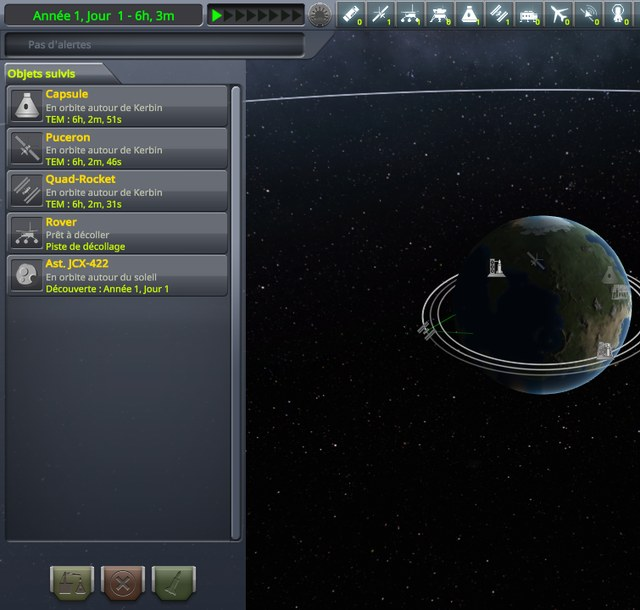
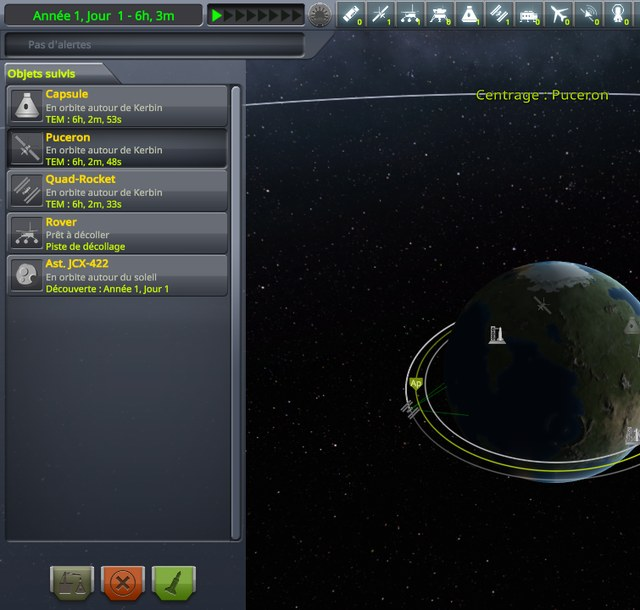
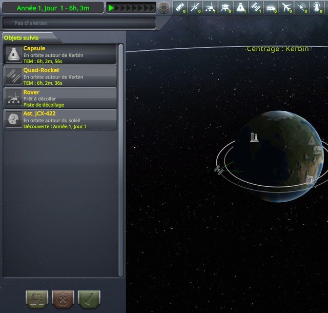
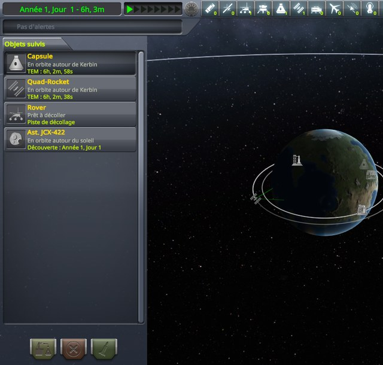
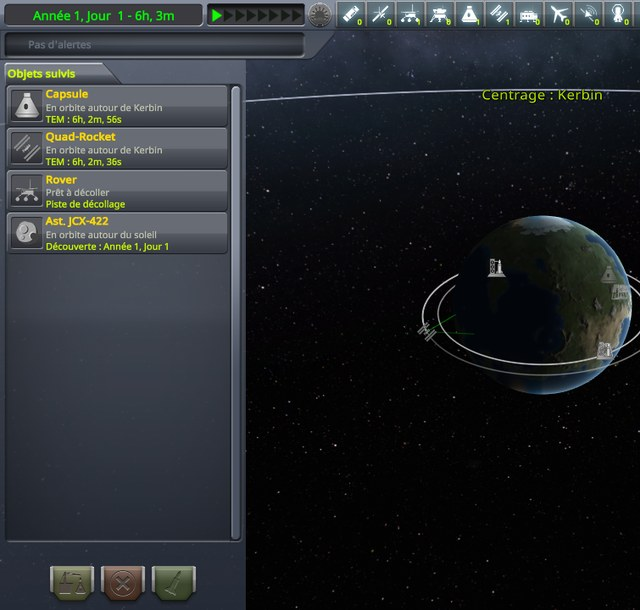
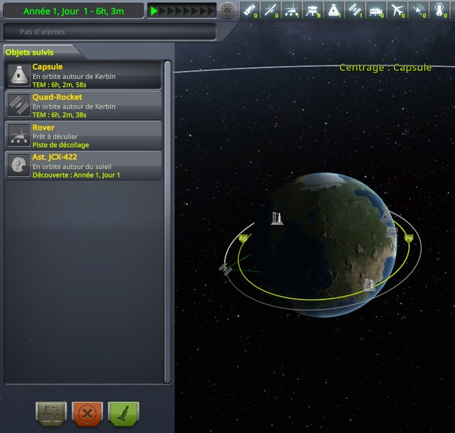

# Checking Terminate

Part of [Tracking Selection Fix](../README.md). A vessel is terminated from the tracking station, then the top row of the list is clicked. Does a single click on it select its vessel? Played without this mod, then with it.

## The install

KSP 1.12.5, in French, in a 1280 × 720 window, with Harmony, ModuleManager,
[KSP Community Fixes](https://github.com/KSPModdingLibs/KSPCommunityFixes) 1.41.1, and
[KSP-Util-MCPServer](https://github.com/lhervier/KSP-Util-MCPServer) for the script that plays the protocol.
Then this mod, at `logLevel = Debug`.

## The protocol

The save, [tracking-selection.sfs](../diag/tracking-selection.sfs): a sandbox game with, around Kerbin, a
capsule in orbit at 100 km (Capsule, a ship), a probe at 150 km (Puceron), a station at 200 km (Quad-Rocket), a
rover on the runway (Rover, the vessel it opens on), and a tracked asteroid (Ast. JCX-422), plus nine untracked
asteroids, which keep the game from finding new ones while the protocol runs. Every vessel filter is on. Copy it
into the folder of a sandbox game, and load it. Then leave the flight for the space centre, and open the tracking
station. On a first visit, it shows a welcome message: close it.

1. Click Puceron.
2. Click *Terminate*, and confirm.
3. Click the top row, Capsule, once.

**Played by a script.** [run-selection.py](../diag/automation/run-selection.py), with `--protocol terminate`. It loads the save, goes to the space centre and to the tracking station as the game's buttons do, and closes a welcome message by its button if one shows. It clicks with the mouse tools of KSP-Util-MCPServer, in the middle of each row and button, which it finds with the server's `read_tracking_station`; and the first button of a confirmation dialog, found with `read_dialogs`.

A screenshot follows each step, the mouse resting right of the list. The images below are the left
part of the screen, 755 by 720 pixels, at 640 pixels wide: the list of tracked objects, its buttons at the
bottom (*Recover*, *Terminate* or *End Track*, *Fly*, from left to right; grey when they do not respond), and the
name of the object the view turns to, which shows for a few seconds at the top of the view (*Centrage : …*). A
selected row is darker than the others.

## On stock

Read off the screenshots below:

| Step | Row that looks selected | Message at the top of the view | Buttons that respond |
|---|---|---|---|
| 1. The tracking station | none | none | none |
| 2. Click on Puceron | Puceron | Centrage : Puceron | Terminate, Fly |
| 3. Terminate | Capsule | Centrage : Kerbin | none |
| 4. Click on the top row | Capsule | none | none |

The top row comes back dark after *Terminate*, with no vessel selected: the buttons are grey, and the view turned to Kerbin. The click on it changes nothing.

<p class="thumbs"><a href="../imgs/checking-terminate/stock/1-tracking-station.jpg"></a> <a href="../imgs/checking-terminate/stock/2-puceron-clicked.jpg"></a> <a href="../imgs/checking-terminate/stock/3-terminated.jpg"></a> <a href="../imgs/checking-terminate/stock/4-top-row-clicked.jpg"></a></p>

<details>
<summary>The 4 screenshots, on stock</summary>

The tracking station:


After the click on Puceron:


After Terminate:


After the click on the top row:


</details>

## With this mod

Read off the screenshots below:

| Step | Row that looks selected | Message at the top of the view | Buttons that respond |
|---|---|---|---|
| 1. The tracking station | none | none | none |
| 2. Click on Puceron | Puceron | Centrage : Puceron | Terminate, Fly |
| 3. Terminate | none | Centrage : Kerbin | none |
| 4. Click on the top row | Capsule | Centrage : Capsule | Terminate, Fly |

No row comes back dark after *Terminate*, and the click on the top row selects Capsule. The log of the mod shows the old rows leaving the list's toggle group, Puceron's first, a vessel no longer in the game:

```
[KSPFixTrackingSelection] [DEBUG] Row of Ast. JCX-422 removed from the list, out of its toggle group
[KSPFixTrackingSelection] [DEBUG] Row of Rover removed from the list, out of its toggle group
[KSPFixTrackingSelection] [DEBUG] Row of Quad-Rocket removed from the list, out of its toggle group
[KSPFixTrackingSelection] [DEBUG] Row of a vessel no longer in the game removed from the list, out of its toggle group
[KSPFixTrackingSelection] [DEBUG] Row of Capsule removed from the list, out of its toggle group
```

<p class="thumbs"><a href="../imgs/checking-terminate/fix/1-tracking-station.jpg"></a> <a href="../imgs/checking-terminate/fix/2-puceron-clicked.jpg"></a> <a href="../imgs/checking-terminate/fix/3-terminated.jpg"></a> <a href="../imgs/checking-terminate/fix/4-top-row-clicked.jpg"></a></p>

<details>
<summary>The 4 screenshots, with this mod</summary>

The tracking station:


After the click on Puceron:


After Terminate:


After the click on the top row:


</details>
