# Checking Tracking Station Evolved

Part of [Tracking Selection Fix](../README.md). [Tracking Station Evolved](https://github.com/linuxgurugamer/KSP_BetterTracking)
replaces the list of the tracking station with its own, grouped by body or by vessel type, sorted and searchable.
Does the stock defect show through it, and does this mod still fix it? The protocols of this mod's other checks,
played with Tracking Station Evolved installed, without this mod, then with it.

## What Tracking Station Evolved does with the list

As its source reads (`Tracking_Controller`, version 1.0.9.1):

- **The station's own list is still there, unseen.** Tracking Station Evolved takes the container of the
  station's rows out of the interface (`SpaceTracking.listContainer`, set to no parent) and shows a copy of it
  instead, which it fills with rows of its own. The station keeps building its own rows in the hidden container,
  as on stock: `SpaceTracking.ConstructUIList` rebuilds them on *Terminate*, *Recover*, *End Track*, a lost object
  or a filter, `TrackingStationWidget.Terminate` removes the old ones, and they stay toggles of
  `SpaceTracking.listToggleGroup`.
- **Its rows pass the clicks on.** A click on one of its rows calls the hidden row's `toggle.onValueChanged`,
  that is `TrackingStationWidget.onToggle`, which selects the vessel; a hidden row that switches on lights the
  matching row of Tracking Station Evolved. Its own rows are toggles of a toggle group of its own, whose first
  toggle is an invisible one: its own rebuilds never light a visible row by themselves.
- **So the defect happens in the hidden list.** After a rebuild with no vessel selected, the station's toggle
  group lights its first hidden row, Capsule's, and marks it selected, as on stock; Tracking Station Evolved,
  which rebuilds its rows a few frames later, shows none of them lit. Nothing looks selected, but Capsule's row,
  wherever Tracking Station Evolved puts it, no longer answers a single click. And the vessel a filter hides stays
  selected, as on stock.
- **Both patches of this mod act on the station's own code**, which Tracking Station Evolved does not replace:
  `TrackingStationWidget.Terminate` and `SpaceTracking.ConstructUIList` still run for the hidden list.

## The install

KSP 1.12.5, in French, in a 1280 × 720 window, with Harmony, ModuleManager,
[KSP Community Fixes](https://github.com/KSPModdingLibs/KSPCommunityFixes) 1.41.1,
[Tracking Station Evolved](https://github.com/linuxgurugamer/KSP_BetterTracking) 1.0.9.1, which needs no other
mod, and [KSP-Util-MCPServer](https://github.com/lhervier/KSP-Util-MCPServer) for the script that plays the
protocols. Then this mod, at `logLevel = Debug`.

## The protocols

The save, [tracking-selection.sfs](../diag/tracking-selection.sfs), and the steps are those of this mod's other
checks, linked from each chapter below. Copy the save into the folder of a sandbox game, and load it. Then leave
the flight for the space centre, and open the tracking station.

Tracking Station Evolved shows its list grouped by body, its default: Kerbin first (Rover, Quad-Rocket, Puceron,
Capsule), then the Sun (Ast. JCX-422). The station's own list, hidden, has Capsule on top, as
on stock: where the other checks click the top row, these click Capsule's row, the row the defect concerns.

**Played by a script.** [run-selection.py](../diag/automation/run-selection.py), with the `--protocol` of each
chapter. It plays them as for the other checks; with Tracking Station Evolved installed, the server's
`read_tracking_station` reads the rows Tracking Station Evolved shows, and the station's own rows, hidden, and
where the other checks click the top row, the script clicks the row of the vessel on top of the hidden list,
Capsule.

A screenshot follows each step, the mouse resting right of the list. The images below are the left
part of the screen, 755 by 720 pixels, at 640 pixels wide: the list of Tracking Station Evolved, the buttons of
the station at the bottom (*Recover*, *Terminate* or *End Track*, *Fly*, from left to right; grey when they do not
respond), and the name of the object the view turns to, which shows for a few seconds at the top of the view
(*Centrage : …*). A selected row is darker than the others. In flight, the image is the top middle of the
screen, 640 by 360 pixels: the altimeter tells which vessel flies (Capsule at 100 km, Puceron at 150 km,
Quad-Rocket at 200 km).

## Terminate

Puceron is clicked, terminated, then Capsule's row is clicked. The steps are those of [Checking Terminate](checking-terminate.md#the-protocol), with Capsule's row in place of the top row.

**→ Full chapter: [Checking Terminate](checking-terminate.md)**

### Without this mod

Read off the screenshots below:

| Step | Row that looks selected | Message at the top of the view | Buttons that respond |
|---|---|---|---|
| 1. The tracking station | none | none | none |
| 2. Click on Puceron | Puceron | Centrage : Puceron | Terminate, Fly |
| 3. Terminate | none | Centrage : Kerbin | none |
| 4. Click on Capsule | Capsule | none | none |

No row looks selected after *Terminate*, yet the click on Capsule only darkens its row: the buttons stay grey, and the view does not move.

<p class="thumbs"><a href="../imgs/checking-tracking-station-evolved/terminate/stock/1-tracking-station.jpg"></a> <a href="../imgs/checking-tracking-station-evolved/terminate/stock/2-puceron-clicked.jpg">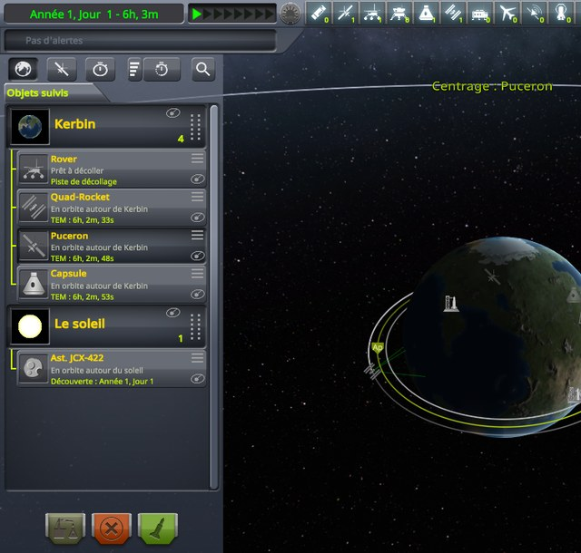</a> <a href="../imgs/checking-tracking-station-evolved/terminate/stock/3-terminated.jpg">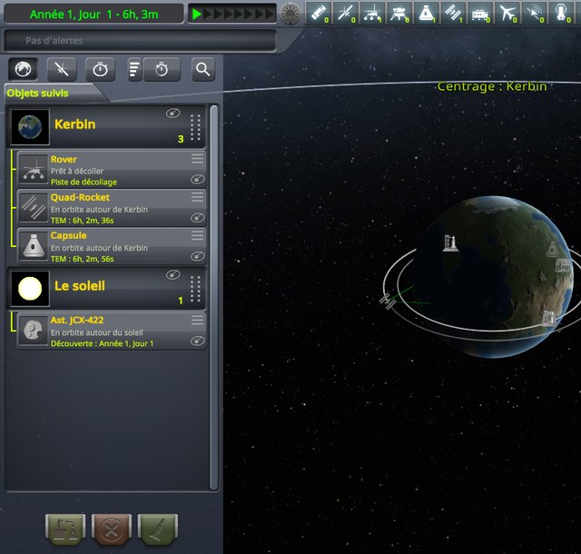</a> <a href="../imgs/checking-tracking-station-evolved/terminate/stock/4-top-row-clicked.jpg"></a></p>

<details>
<summary>The 4 screenshots, without this mod</summary>

The tracking station:


After the click on Puceron:


After Terminate:


After the click on Capsule:


</details>

### With this mod

Read off the screenshots below:

| Step | Row that looks selected | Message at the top of the view | Buttons that respond |
|---|---|---|---|
| 1. The tracking station | none | none | none |
| 2. Click on Puceron | Puceron | Centrage : Puceron | Terminate, Fly |
| 3. Terminate | none | Centrage : Kerbin | none |
| 4. Click on Capsule | Capsule | Centrage : Capsule | Terminate, Fly |

The click on Capsule selects it.

<p class="thumbs"><a href="../imgs/checking-tracking-station-evolved/terminate/fix/1-tracking-station.jpg">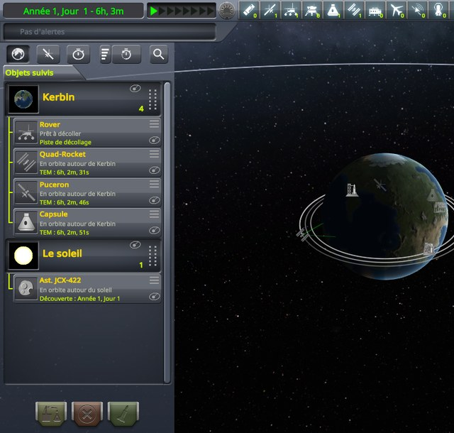</a> <a href="../imgs/checking-tracking-station-evolved/terminate/fix/2-puceron-clicked.jpg"></a> <a href="../imgs/checking-tracking-station-evolved/terminate/fix/3-terminated.jpg"></a> <a href="../imgs/checking-tracking-station-evolved/terminate/fix/4-top-row-clicked.jpg"></a></p>

<details>
<summary>The 4 screenshots, with this mod</summary>

The tracking station:


After the click on Puceron:


After Terminate:


After the click on Capsule:


</details>

## Recover

The rover on the runway is clicked, recovered, then Capsule's row is clicked. The steps are those of [Checking Recover](checking-recover.md#the-protocol), with Capsule's row in place of the top row.

**→ Full chapter: [Checking Recover](checking-recover.md)**

### Without this mod

Read off the screenshots below:

| Step | Row that looks selected | Message at the top of the view | Buttons that respond |
|---|---|---|---|
| 1. The tracking station | none | none | none |
| 2. Click on Rover | Rover | Centrage : Rover | Recover, Fly |
| 3. Recover | none | none | none |
| 4. Click on Capsule | Capsule | none | none |

The click on Capsule only darkens its row, with nothing selected.

<p class="thumbs"><a href="../imgs/checking-tracking-station-evolved/recover/stock/1-tracking-station.jpg"></a> <a href="../imgs/checking-tracking-station-evolved/recover/stock/2-rover-clicked.jpg"></a> <a href="../imgs/checking-tracking-station-evolved/recover/stock/3-recovered.jpg">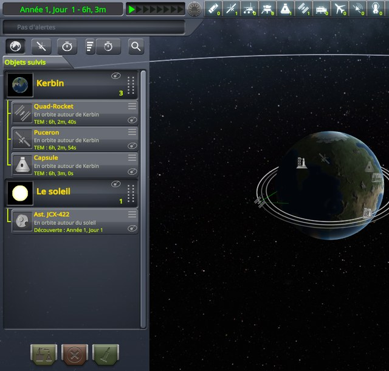</a> <a href="../imgs/checking-tracking-station-evolved/recover/stock/4-top-row-clicked.jpg">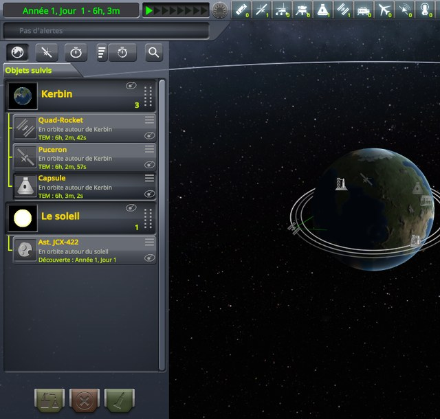</a></p>

<details>
<summary>The 4 screenshots, without this mod</summary>

The tracking station:


After the click on Rover:


After Recover:


After the click on Capsule:


</details>

### With this mod

Read off the screenshots below:

| Step | Row that looks selected | Message at the top of the view | Buttons that respond |
|---|---|---|---|
| 1. The tracking station | none | none | none |
| 2. Click on Rover | Rover | Centrage : Rover | Recover, Fly |
| 3. Recover | none | none | none |
| 4. Click on Capsule | Capsule | Centrage : Capsule | Terminate, Fly |

The click on Capsule selects it.

<p class="thumbs"><a href="../imgs/checking-tracking-station-evolved/recover/fix/1-tracking-station.jpg"></a> <a href="../imgs/checking-tracking-station-evolved/recover/fix/2-rover-clicked.jpg">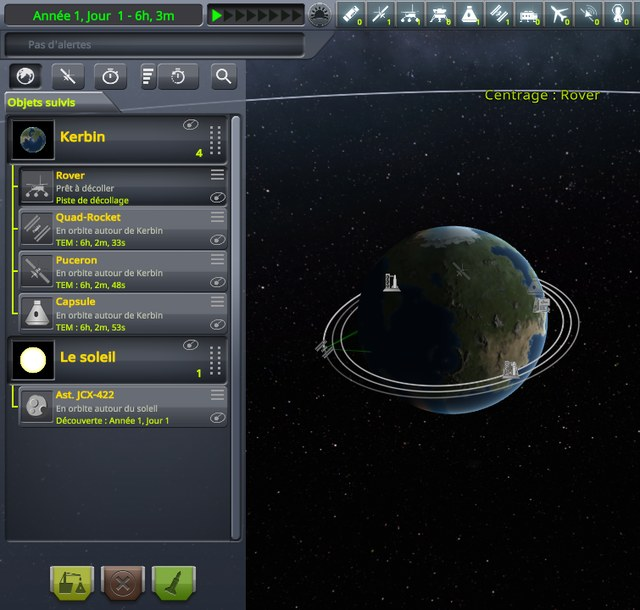</a> <a href="../imgs/checking-tracking-station-evolved/recover/fix/3-recovered.jpg"></a> <a href="../imgs/checking-tracking-station-evolved/recover/fix/4-top-row-clicked.jpg">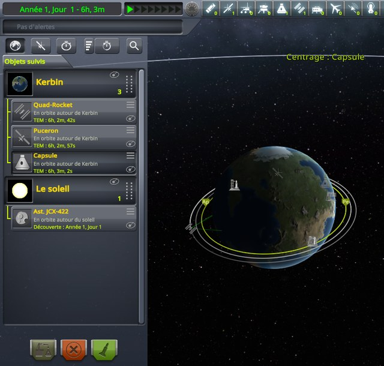</a></p>

<details>
<summary>The 4 screenshots, with this mod</summary>

The tracking station:


After the click on Rover:


After Recover:


After the click on Capsule:


</details>

## End Track

The tracked asteroid is clicked, its tracking ended, then Capsule's row is clicked. The steps are those of [Checking End Track](checking-end-track.md#the-protocol), with Capsule's row in place of the top row.

**→ Full chapter: [Checking End Track](checking-end-track.md)**

### Without this mod

Read off the screenshots below:

| Step | Row that looks selected | Message at the top of the view | Buttons that respond |
|---|---|---|---|
| 1. The tracking station | none | none | none |
| 2. Click on Ast. JCX-422 | Ast. JCX-422 | Centrage : Ast. JCX-422 | End Track |
| 3. End Track | none | none | none |
| 4. Click on Capsule | Capsule | none | none |

The click on Capsule only darkens its row, with nothing selected.

<p class="thumbs"><a href="../imgs/checking-tracking-station-evolved/end-track/stock/1-tracking-station.jpg"></a> <a href="../imgs/checking-tracking-station-evolved/end-track/stock/2-asteroid-clicked.jpg"></a> <a href="../imgs/checking-tracking-station-evolved/end-track/stock/3-tracking-ended.jpg">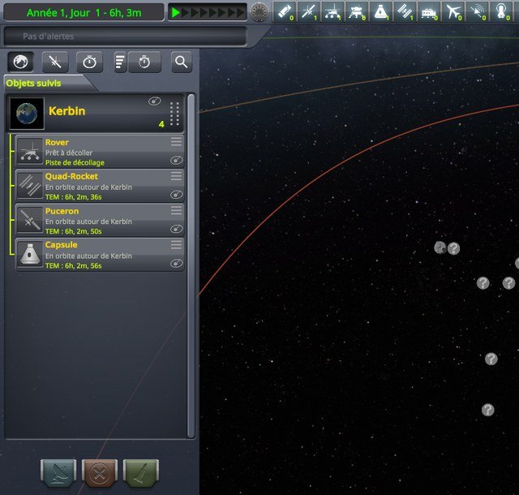</a> <a href="../imgs/checking-tracking-station-evolved/end-track/stock/4-top-row-clicked.jpg">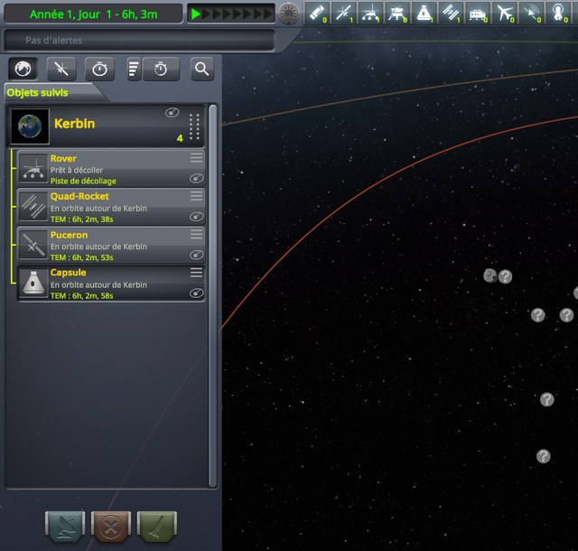</a></p>

<details>
<summary>The 4 screenshots, without this mod</summary>

The tracking station:


After the click on Ast. JCX-422:


After End Track:


After the click on Capsule:


</details>

### With this mod

Read off the screenshots below:

| Step | Row that looks selected | Message at the top of the view | Buttons that respond |
|---|---|---|---|
| 1. The tracking station | none | none | none |
| 2. Click on Ast. JCX-422 | Ast. JCX-422 | Centrage : Ast. JCX-422 | End Track |
| 3. End Track | none | none | none |
| 4. Click on Capsule | Capsule | Centrage : Capsule | Terminate, Fly |

The click on Capsule selects it.

<p class="thumbs"><a href="../imgs/checking-tracking-station-evolved/end-track/fix/1-tracking-station.jpg"></a> <a href="../imgs/checking-tracking-station-evolved/end-track/fix/2-asteroid-clicked.jpg">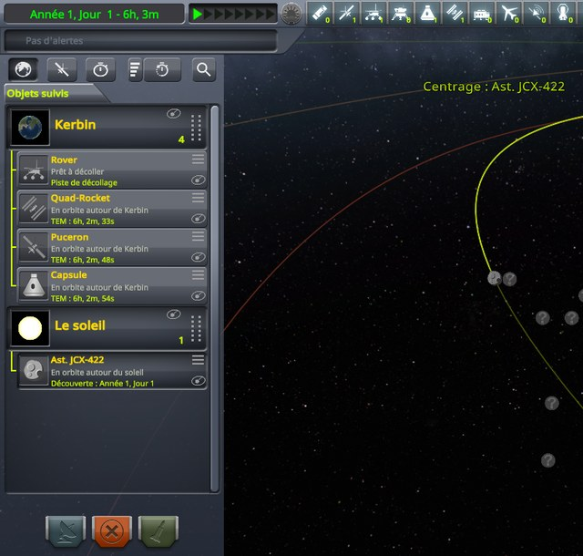</a> <a href="../imgs/checking-tracking-station-evolved/end-track/fix/3-tracking-ended.jpg"></a> <a href="../imgs/checking-tracking-station-evolved/end-track/fix/4-top-row-clicked.jpg">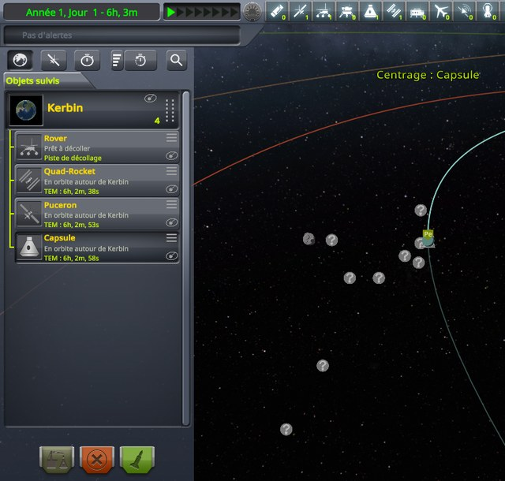</a></p>

<details>
<summary>The 4 screenshots, with this mod</summary>

The tracking station:


After the click on Ast. JCX-422:


After End Track:


After the click on Capsule:


</details>

## An object lost

An untracked asteroid is lost while the tracking station is open, nothing selected; then Capsule's row is clicked. The steps are those of [Checking an object lost](checking-lost-object.md#the-protocol), with Capsule's row in place of the top row.

**→ Full chapter: [Checking an object lost](checking-lost-object.md)**

### Without this mod

Read off the screenshots below:

| Step | Row that looks selected | Message at the top of the view | Buttons that respond |
|---|---|---|---|
| 1. The tracking station | none | none | none |
| 2. The object lost | none | none | none |
| 3. Click on Capsule | Capsule | none | none |

Nothing changes on screen when the object is lost, yet the click on Capsule only darkens its row, with nothing selected.

<p class="thumbs"><a href="../imgs/checking-tracking-station-evolved/lost-object/stock/1-tracking-station.jpg"></a> <a href="../imgs/checking-tracking-station-evolved/lost-object/stock/2-object-lost.jpg">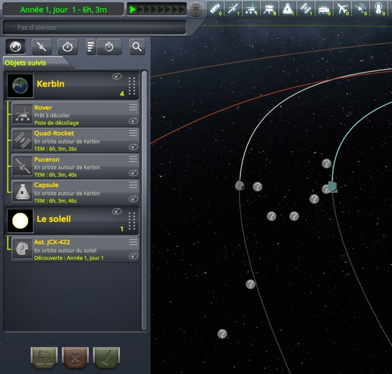</a> <a href="../imgs/checking-tracking-station-evolved/lost-object/stock/3-top-row-clicked.jpg">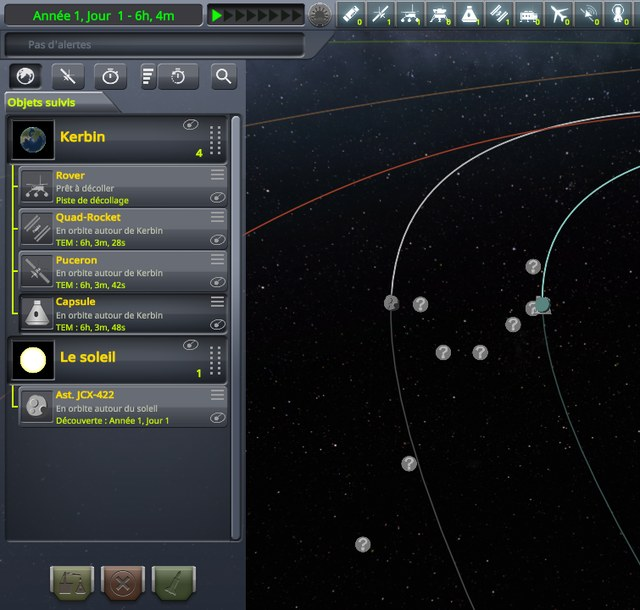</a></p>

<details>
<summary>The 3 screenshots, without this mod</summary>

The tracking station:


After the object is lost:


After the click on Capsule:


</details>

### With this mod

Read off the screenshots below:

| Step | Row that looks selected | Message at the top of the view | Buttons that respond |
|---|---|---|---|
| 1. The tracking station | none | none | none |
| 2. The object lost | none | none | none |
| 3. Click on Capsule | Capsule | Centrage : Capsule | Terminate, Fly |

The click on Capsule selects it.

<p class="thumbs"><a href="../imgs/checking-tracking-station-evolved/lost-object/fix/1-tracking-station.jpg">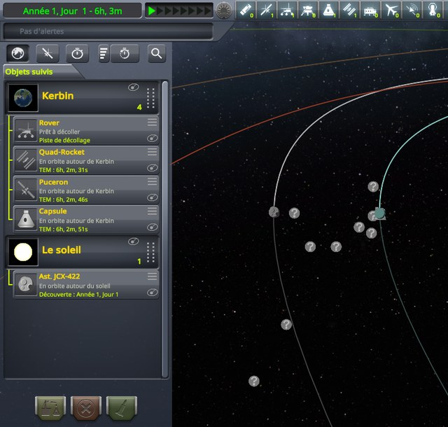</a> <a href="../imgs/checking-tracking-station-evolved/lost-object/fix/2-object-lost.jpg"></a> <a href="../imgs/checking-tracking-station-evolved/lost-object/fix/3-top-row-clicked.jpg"></a></p>

<details>
<summary>The 3 screenshots, with this mod</summary>

The tracking station:


After the object is lost:


After the click on Capsule:


</details>

## A filter

Quad-Rocket is clicked, ships alone are shown, Capsule's row is clicked, then *Fly*. The steps are those of [Checking a filter](checking-filter.md#the-protocol), with Capsule's row in place of the top row.

**→ Full chapter: [Checking a filter](checking-filter.md)**

### Without this mod

Read off the screenshots below:

| Step | Row that looks selected | Message at the top of the view | Buttons that respond |
|---|---|---|---|
| 1. The tracking station | none | none | none |
| 2. Click on Quad-Rocket | Quad-Rocket | Centrage : Quad-Rocket | Terminate, Fly |
| 3. Right-click on *Ships* | none | none | Terminate, Fly |
| 4. Click on Capsule | Capsule | none | Terminate, Fly |
| 5. *Fly* | — | — | the altimeter reads 199 998 m: Quad-Rocket |

Quad-Rocket stays selected once ships alone show, with no row: the click on Capsule only darkens Capsule's row, and *Fly* flies Quad-Rocket.

<p class="thumbs"><a href="../imgs/checking-tracking-station-evolved/filter/stock/1-tracking-station.jpg">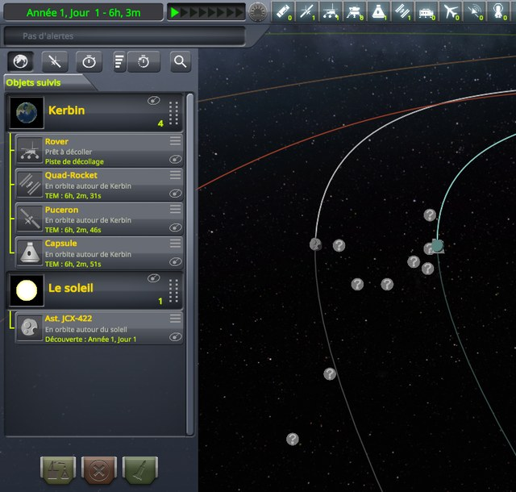</a> <a href="../imgs/checking-tracking-station-evolved/filter/stock/2-quad-rocket-clicked.jpg">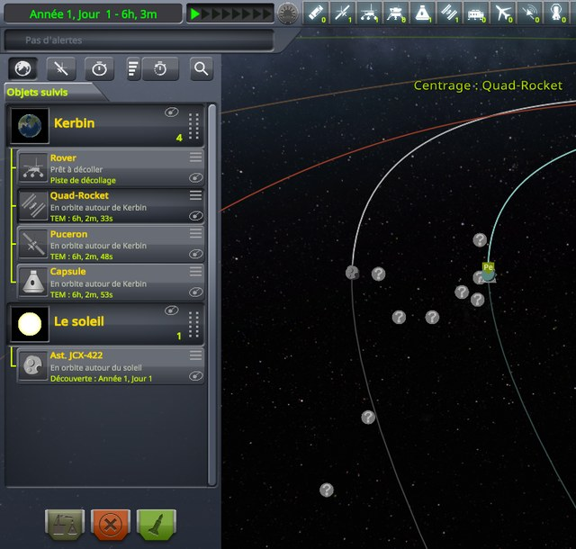</a> <a href="../imgs/checking-tracking-station-evolved/filter/stock/3-ships-right-clicked.jpg">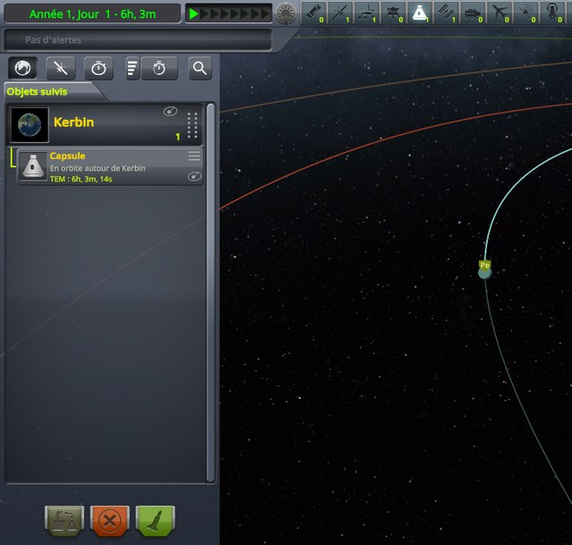</a> <a href="../imgs/checking-tracking-station-evolved/filter/stock/4-top-row-clicked.jpg">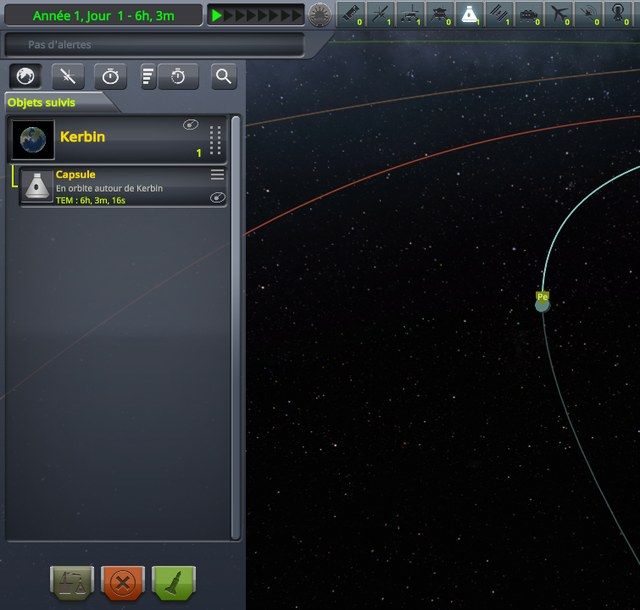</a> <a href="../imgs/checking-tracking-station-evolved/filter/stock/5-fly-clicked.jpg">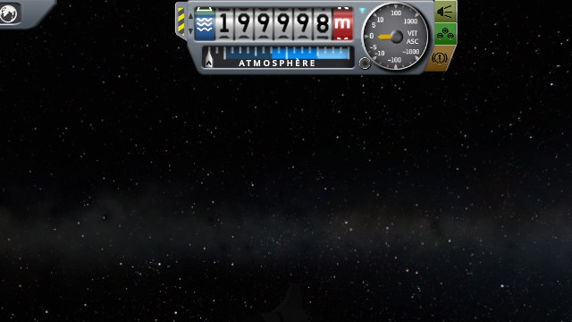</a></p>

<details>
<summary>The 5 screenshots, without this mod</summary>

The tracking station:


After the click on Quad-Rocket:


After the right-click on Ships:


After the click on Capsule:


After Fly:


</details>

### With this mod

Read off the screenshots below:

| Step | Row that looks selected | Message at the top of the view | Buttons that respond |
|---|---|---|---|
| 1. The tracking station | none | none | none |
| 2. Click on Quad-Rocket | Quad-Rocket | Centrage : Quad-Rocket | Terminate, Fly |
| 3. Right-click on *Ships* | none | none | none |
| 4. Click on Capsule | Capsule | Centrage : Capsule | Terminate, Fly |
| 5. *Fly* | — | — | the altimeter reads 99 999 m: Capsule |

Quad-Rocket is deselected when ships alone show; the click on Capsule selects it, and *Fly* flies it. The log of the mod shows the deselection:

```
[KSPFixTrackingSelection] [DEBUG] Quad-Rocket is selected but the filters hide it: deselected
```

<p class="thumbs"><a href="../imgs/checking-tracking-station-evolved/filter/fix/1-tracking-station.jpg"></a> <a href="../imgs/checking-tracking-station-evolved/filter/fix/2-quad-rocket-clicked.jpg"></a> <a href="../imgs/checking-tracking-station-evolved/filter/fix/3-ships-right-clicked.jpg">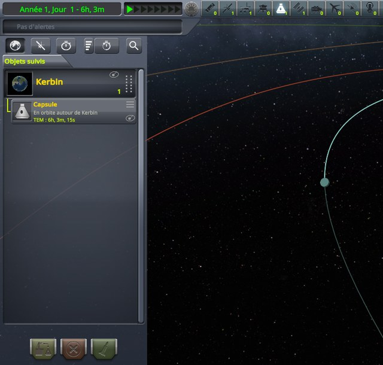</a> <a href="../imgs/checking-tracking-station-evolved/filter/fix/4-top-row-clicked.jpg"></a> <a href="../imgs/checking-tracking-station-evolved/filter/fix/5-fly-clicked.jpg">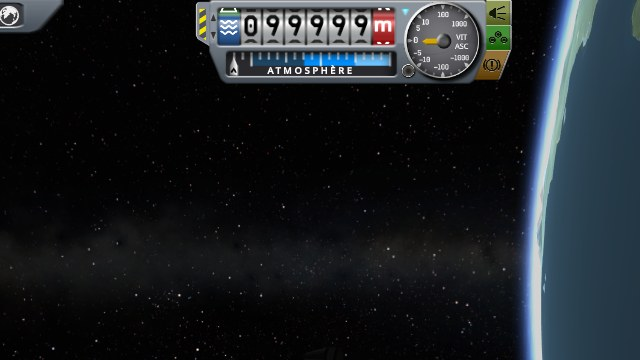</a></p>

<details>
<summary>The 5 screenshots, with this mod</summary>

The tracking station:


After the click on Quad-Rocket:


After the right-click on Ships:


After the click on Capsule:


After Fly:


</details>

## The clicks that already worked

Capsule is clicked, clicked again, and Puceron double-clicked. The steps are those of [Checking the clicks that already worked](checking-clicks.md#the-protocol), with Capsule's row in place of the top row.

**→ Full chapter: [Checking the clicks that already worked](checking-clicks.md)**

### Without this mod

Read off the screenshots below:

| Step | Row that looks selected | Message at the top of the view | Buttons that respond |
|---|---|---|---|
| 1. The tracking station | none | none | none |
| 2. Click on Capsule | Capsule | Centrage : Capsule | Terminate, Fly |
| 3. Click on Capsule again | Capsule | none | Terminate, Fly |
| 4. Double click on Puceron | — | — | the altimeter reads 150 000 m: Puceron |

The click selects Capsule, the second click leaves it selected, and the double click flies Puceron.

<p class="thumbs"><a href="../imgs/checking-tracking-station-evolved/clicks/stock/1-tracking-station.jpg"></a> <a href="../imgs/checking-tracking-station-evolved/clicks/stock/2-capsule-clicked.jpg"></a> <a href="../imgs/checking-tracking-station-evolved/clicks/stock/3-capsule-clicked-again.jpg">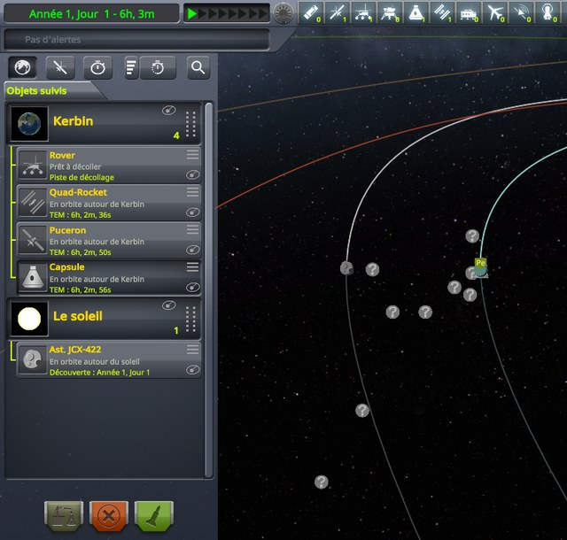</a> <a href="../imgs/checking-tracking-station-evolved/clicks/stock/4-puceron-double-clicked.jpg">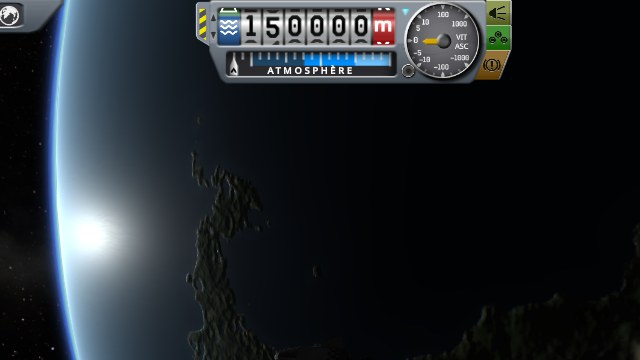</a></p>

<details>
<summary>The 4 screenshots, without this mod</summary>

The tracking station:


After the click on Capsule:


After the second click on Capsule:


After the double click on Puceron:


</details>

### With this mod

Read off the screenshots below:

| Step | Row that looks selected | Message at the top of the view | Buttons that respond |
|---|---|---|---|
| 1. The tracking station | none | none | none |
| 2. Click on Capsule | Capsule | Centrage : Capsule | Terminate, Fly |
| 3. Click on Capsule again | Capsule | none | Terminate, Fly |
| 4. Double click on Puceron | — | — | the altimeter reads 150 000 m: Puceron |

The same.

<p class="thumbs"><a href="../imgs/checking-tracking-station-evolved/clicks/fix/1-tracking-station.jpg"></a> <a href="../imgs/checking-tracking-station-evolved/clicks/fix/2-capsule-clicked.jpg"></a> <a href="../imgs/checking-tracking-station-evolved/clicks/fix/3-capsule-clicked-again.jpg"></a> <a href="../imgs/checking-tracking-station-evolved/clicks/fix/4-puceron-double-clicked.jpg"></a></p>

<details>
<summary>The 4 screenshots, with this mod</summary>

The tracking station:


After the click on Capsule:


After the second click on Capsule:


After the double click on Puceron:


</details>

## Its own sorts

Tracking Station Evolved sorts its list by body, by vessel type or as the station does, with the buttons above
it. A change of sort rebuilds its rows alone: the station's list is not rebuilt, and neither patch of this mod
runs.

- **A selected vessel loses its lit row when the list is sorted again, with or without this mod.** Without this
  mod, the list sorted by vessel type: Puceron clicked, then the list sorted by body. The view stays on Puceron
  and its buttons respond, but no row looks selected. This is Tracking Station Evolved's own: its new rows are
  lit only when a row of the hidden list switches on.

  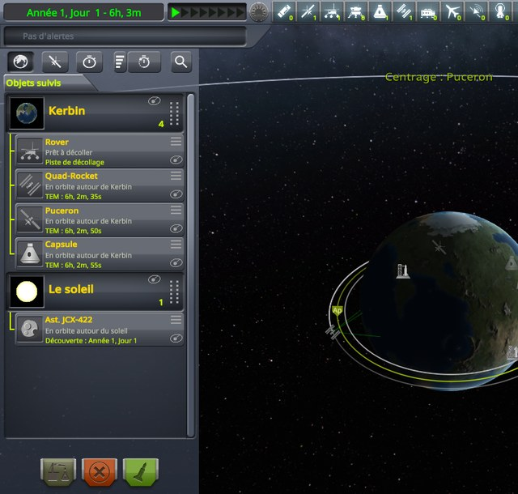

- **The defect and the fix are the same in another sort.** With this mod: Puceron clicked, the list sorted by
  vessel type, Puceron terminated, then Capsule's row clicked. Capsule is selected.

  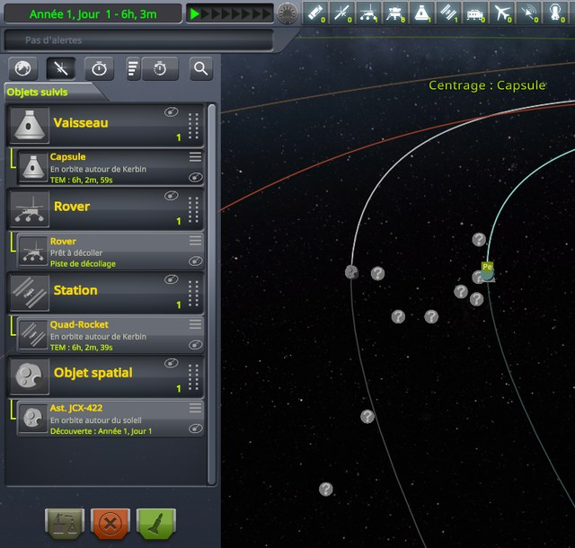

*The install of the protocols above. The save of the protocols, loaded, then the tracking station, and the
clicks said above each image.*

## In KSP.log

No exception from Tracking Station Evolved or from this mod in any of the runs, with this mod or without it.
With it, the log shows the same lines as without Tracking Station Evolved, one for each hidden row removed from
the list:

```
[KSPFixTrackingSelection] [DEBUG] Row of Capsule removed from the list, out of its toggle group
```
